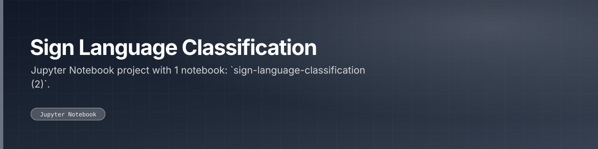

 

 

---

## What this is

Jupyter Notebook project with 1 notebook: `sign-language-classification (2)`. Also checked in: 1 markdown document. The sections below are read from the repository itself, 7 tracked files as of 2023-11-15.

|  |
|:--:|
| **1** |
| docs |

---

<a href="https://github.com/gowtham-creator/Sign-language-classification">gowtham-creator/Sign-language-classification</a>

